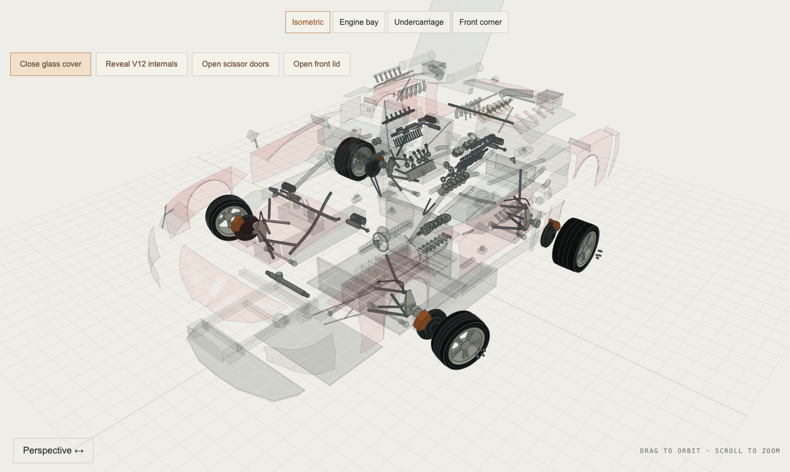

# 

**me / mechanic** makes learning about car parts simpler and more fun. Explore a car in 3D, see what its components do, and take the assembly apart to understand how it fits together.

The name is inspired by Kevin Malone from *The Office* and his friendship with his mechanic:


> “Me mechanic not speak English. But he know what me mean when me say ‘car no go’, and we best friends. So me think: why waste time, say lot word when few word do trick?”



The first study is a reconstructed Lamborghini Aventador LP 700–4, with 431 selectable component groups.

## Explore the car

- Hover over a component or its name in the assembly index to see its details. Click once to select it, again to focus on it, and once more to return to the previous view.
- Open the doors, front lid and engine cover, or reveal the V12 internals. Use depth peel and the explode slider to look inside the assembly.
- Remove and reinstall parts, optionally enforcing the model's illustrative removal order.
- Run the engine and adjust engine speed, gear, steering and suspension travel. Slow motion makes the moving geometry easier to follow.
- Switch camera views, perspective, and the paper or blueprint theme.

## Getting started

You need Node.js and npm. From the project directory:

```sh
npm install
npm run dev
```

Open the local URL printed by Vite. The app runs in the browser without a backend or API keys. To check and build it:

```sh
npm test
npm run verify:parts
npm run build
```

The production build is written to `dist/` and can be served by a static host.

## Model and assets

The model covers bodywork, chassis, powertrain, suspension, brakes, underbody, interior and electrical components. The app loads `public/models/aventador.glb` and matches its meshes to the metadata in `src/aventador-parts.json`.

The Blender generator produces both files and `blender/aventador.blend`. To regenerate them, install Blender and run:

```sh
npm run assets
```

The script defaults to the macOS Blender installation at `/Applications/Blender.app/Contents/MacOS/Blender`; set `BLENDER` to use another executable. Add `-- --render <dir>` to produce Workbench check renders. See [ASSET_PIPELINE.md](ASSET_PIPELINE.md) for the geometry and rendering pipeline.

## Accuracy and verification

This is an independent teaching model, not an OEM CAD model, workshop guide or validated vehicle simulator. Geometry, component positions, removal order and some mechanical values are illustrative; the model does not include every vehicle part. Steering and suspension motion are visual demonstrations, and valves do not follow the cam lobes.

All 431 component groups have matching GLB mesh nodes. This verifies consistency between the model and its metadata, not factory accuracy or completeness. See [PARTS_VERIFICATION.md](PARTS_VERIFICATION.md) and the [component inventory](reports/component-inventory.csv) for known gaps and discrepancies.

The engine's 60° bank angle and 76.4 mm stroke are based on the [Lamborghini launch press kit](https://www.ausmotive.com/downloads/Lamborghini/Aventador-full-release-Mar2011.pdf), a manufacturer document mirrored by Ausmotive. No licensed Lamborghini mesh, logos or third-party model is bundled.

## Built with

Vite, React, TypeScript, React Three Fiber, Drei, Three.js, Zustand and Blender.
